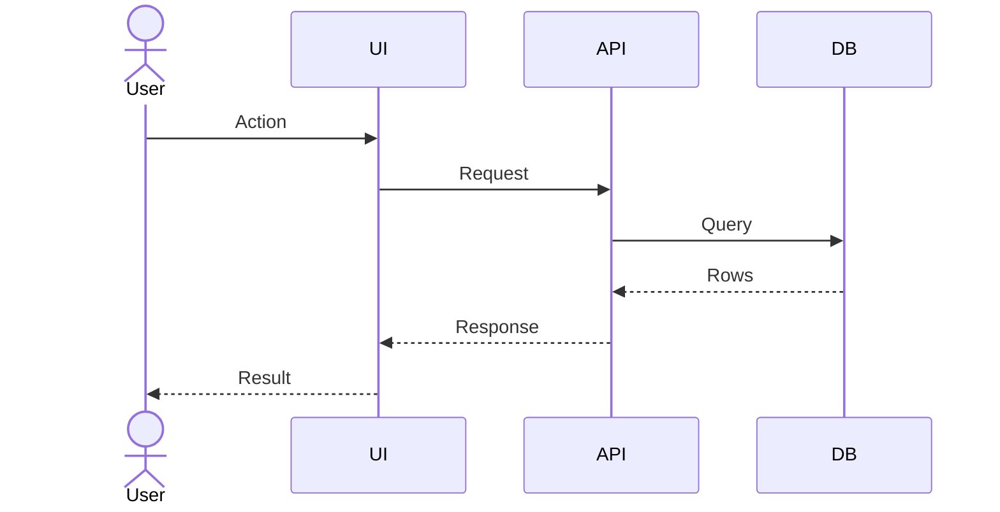
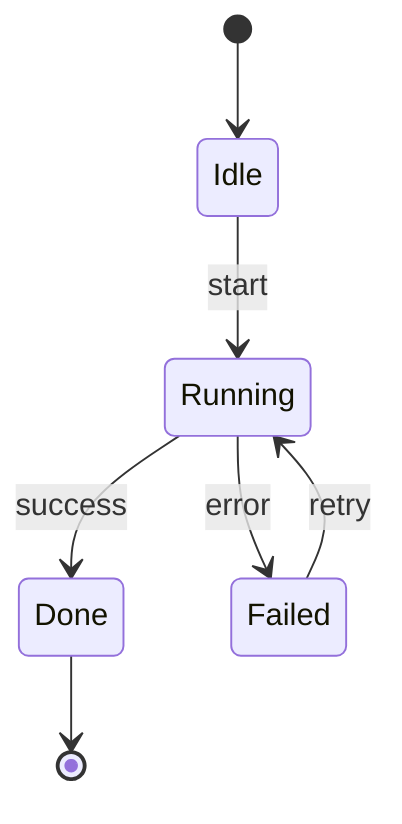
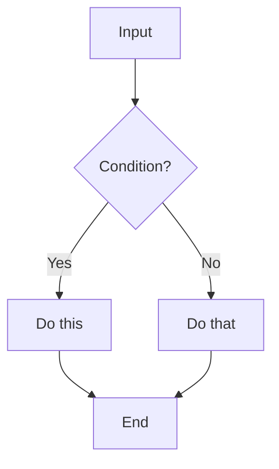
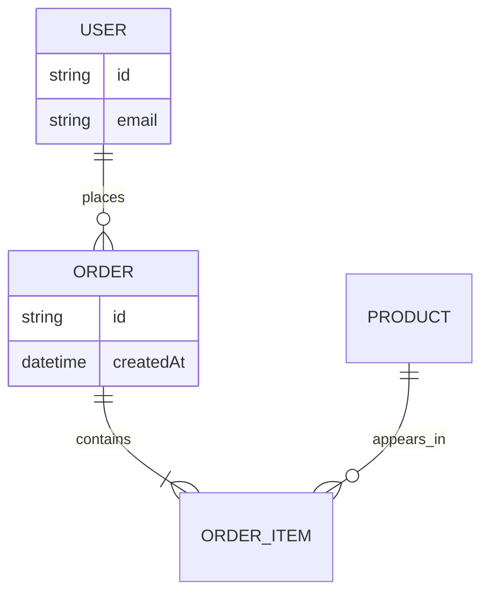
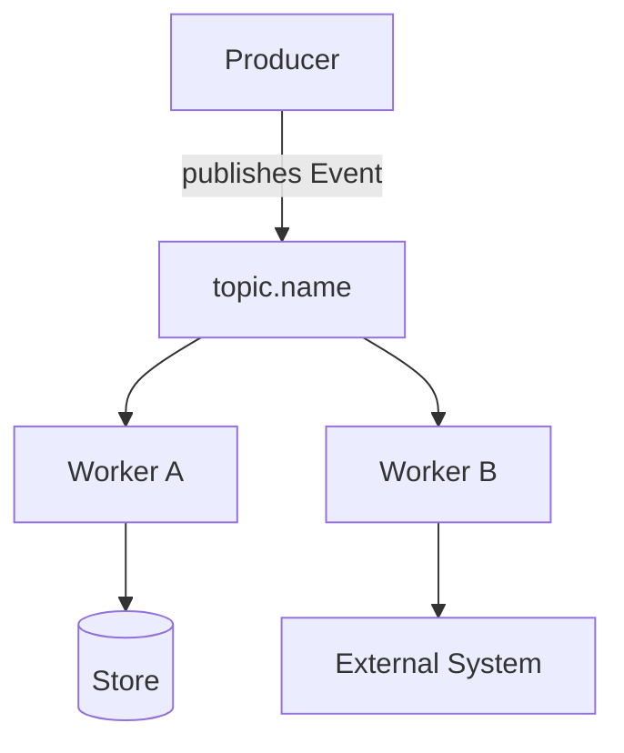

# diagram — create Mermaid diagrams for a project

Help document a project with **Mermaid** diagrams. A good diagram answers **one
specific question**, is grounded in what the project actually does, and lives in the
docs next to a short description so a reader can check their understanding against it.

Output is always a portable fenced ` ```mermaid ` block — no theme or build-system
assumptions. Mermaid renders on GitHub, GitLab, Obsidian, VS Code, and most docs tools.

**Code maps are not drawn here.** A diagram of how a codebase fits together (what surrounds it,
its deployable pieces, the building blocks inside one, where it runs) belongs to the xray
plugin, in any language: `/xray:onboard` draws them from evidence (on TypeScript/JavaScript,
from the real import graph) and `/xray:check-diagrams` keeps existing ones true. When the user
asks for one, say so and hand over; if the plugin isn't installed, tell them how
(`claude plugin marketplace add pearpages/xray`, then `claude plugin install xray@xray`).

Before starting, follow `${CLAUDE_PLUGIN_ROOT}/references/project-context.md`. For this skill
that means `architecture.md` (and `GLOSSARY.md` for names, when it exists); an edit to
`architecture.md` is shown first and made on the user's OK.

## Step 1 — Decide what to show, then pick the type

Pin down the **one question** the diagram should answer, then choose the type:

| Question                          | Diagram type           | Mermaid                |
| --------------------------------- | ---------------------- | ---------------------- |
| What happens step by step?        | **Sequence**           | `sequenceDiagram`      |
| What states can this thing be in? | **State**              | `stateDiagram-v2`      |
| How is a decision made?           | **Flowchart**          | `flowchart`            |
| How is data related?              | **ER**                 | `erDiagram`            |
| How do async events move?         | **Event flow**         | `flowchart`            |
| How do options compare?           | **Decision table**     | Markdown table         |

If several types fit the same content, offer more than one — they complement each other.

## Step 2 — Ground the diagram in the repo

Before drawing, gather real detail so the diagram matches the project (don't invent
nodes). Read, as relevant:

- `README*`, `docs/`, `ARCHITECTURE*`, ADRs — stated structure and intent.
- Package manifests — `package.json`, `pyproject.toml`/`requirements.txt`, `go.mod`,
  `pom.xml`/`build.gradle`, `Cargo.toml`, `Gemfile` — services, deps, scripts.
- Entry points and the code the flow runs through (`main`, `index`, `cmd/`, handlers,
  jobs) — the real participants of a sequence and the real steps of a flow.
- Queues, topics, workers, webhooks — for event flows.
- Schema/migrations/ORM models — for ER diagrams.

Map findings to nodes. When the subject isn't represented in code (a planned design, an
external flow), **ask the user** to describe it instead of guessing.

## Step 3 — Place it in the docs

1. Find the best existing markdown target — the nearest `README`, an ADR, or a design
   doc — and insert the diagram at the logical spot.
2. If nothing fits, propose creating `docs/diagrams.md` (or a path the user prefers).
3. Show where it will go; never overwrite unrelated content. Each diagram gets a
   heading and a one-line description (see conventions).

## Conventions

- **One question per diagram, named in its heading.** "How checkout creates a payment", not
  "Complete architecture". If it gets noisy, split it; when even a split would be noisy, use a
  table.
- **One plain sentence next to it** saying what it shows, so the reader can check their picture
  against the render. Diagrams complement the prose; the prose still stands alone.
- **One real-world thing is exactly one node.** Two nodes with the same label read as two
  things. Something that both gives and receives (a shared cache, a queue) gets one node with
  arrows both ways. A side-by-side comparison in two `subgraph`s is the exception.
- **Top to bottom** (`flowchart TD`) by default; `LR` only for short chains of about 3–4 nodes. A
  wide diagram overflows or shrinks to nothing on a phone.
- **Boundaries are `subgraph`s.** Use `flowchart`, not Mermaid's `C4Context` type, which renders
  poorly.
- **Quote labels that hold punctuation** (`kyc["Know Your Customer (KYC) provider"]`) and expand
  acronyms on first use, inside the diagram too.
- **Sequence arrows carry meaning:** solid `->>` is a call or request, dashed `-->>` its reply.
- **Categories get a picture too:** a 2×2 is a `quadrantChart`, layers are stacked `subgraph`s, a
  classification is a `flowchart TD` with diamonds, a simple taxonomy is a tree or a `mindmap`.
- **Portable output:** a bare ` ```mermaid ` fence, no theme or config assumptions.

## Templates

Generalize these; replace the placeholder nodes with real ones from Step 2.

### Sequence — step-by-step interaction (order matters)



### State — lifecycle of one thing



### Flowchart — branching logic / a decision



### ER — data model and relationships



### Event flow — asynchronous messaging



### Decision table — compare options (when a diagram would be too noisy)

| Condition          | Option A | Option B | Option C |
| ------------------ | -------- | -------- | -------- |
| Criterion 1        | Good     | Weak     | Maybe    |
| Criterion 2        | Weak     | Good     | Maybe    |
| Criterion 3        | Maybe    | Maybe    | Good     |

## Notes

- This is a global, project-agnostic skill — make no assumptions about framework, build
  tooling, or a specific repo layout.
- Keep the diagram and its description together so they stay in sync.
- Verify each fenced block uses the correct diagram keyword and quotes any node label
  containing parentheses, slashes, or other punctuation.
